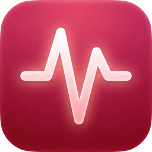
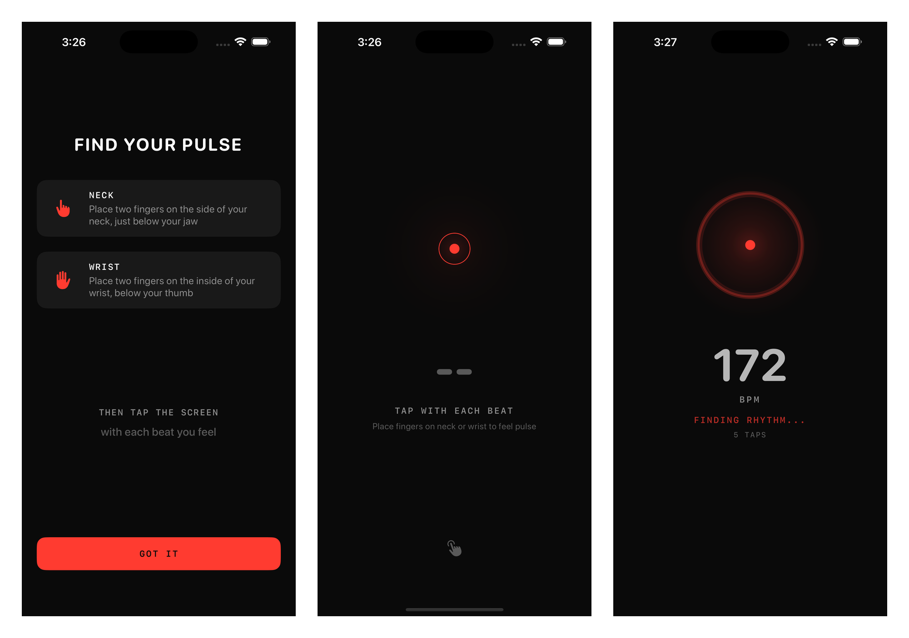

<h1>Pulse</h1>

Measure heart rate by tapping the screen in rhythm with a pulse you feel.

<strong>Version 1.0</strong> · iPhone · iOS 17+

  
  
  

  

Pulse is for checking a heart rate when there's no watch or sensor around: feel the pulse on a neck or wrist, tap with each beat, and read the BPM.

- Works from a pulse you feel, so it can read someone else's too.
- Asks for no camera, microphone or account.
- Answers each tap with a haptic tick, then clears itself after five idle seconds.

## How it works

Each tap is timestamped. Pulse averages the gaps between taps, drops intervals that are half or double the average, and shows 60 divided by that gap as BPM. The number turns red after eight taps and a reading between 40 and 220.

## Privacy

Pulse makes no network requests and uses no HealthKit or other system permissions. The only thing it stores is a flag that you've seen the intro screen.

## Limits

The result is an estimate from your taps, not a medical measurement, and the app says so. It runs on iPhone only, and the screen stays awake while it's open.

## Install

Get it from the App Store, or open `Pulse.xcodeproj` in Xcode, choose your iPhone and run it. There are no packages or API keys.

---

[MIT](LICENSE)

Made by [santiagoalonso.com](https://santiagoalonso.com)
